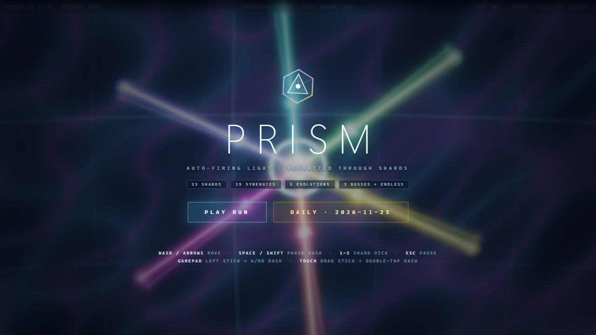

# Prism 2.0

[](https://prism.ericrolph.workers.dev/)
[](https://github.com/eric-rolph/prism-game)

Auto-firing light, refracted through shards you collect — paired with **hostile Ghost Player Sniper Duels**, **cumulative Optical Mastery + RMB Dead-Eye Overdrive**, **6 multi-phase bosses**, **4 playable Prism Cores**, and a **6-movement procedural classic/modern Web Audio soundtrack**. Built in **Rust + WebAssembly + WebGL2 + TypeScript** and deployed to **Cloudflare Workers + SQLite Durable Objects** (~118 kB gzip, zero external assets, strict `default-src 'none'` CSP).

**[▶ Play Live at prism.ericrolph.workers.dev](https://prism.ericrolph.workers.dev/)**

<p align="center">
  <a href="https://prism.ericrolph.workers.dev/">
    
  </a>
</p>

<p align="center">
  <a href="https://prism.ericrolph.workers.dev/">
    
  </a>
</p>

## Controls

- **Keyboard + Mouse (Full Hybrid Mode):**
  - `WASD` / Arrow keys — glide across the 3D sphere
  - **Mouse Aim + Left Click (`LMB`)** — counter-snipe hostile **Pink Ghost Player Snipers**, shatter **Boss Weakpoints / Lattice Relays / Reflector Rear Cores**, or fire precision-crit **Focused Prism Lances** (modified by your shards!); **Hold `LMB`** on orbital **Track Hunter Ghosts** to break their lock
  - **Right Click (`RMB`) / `Q`** — trigger **Prismatic Dead-Eye Overdrive** when 100% charged (`0.32×` time-dilation — sweep cursor to paint up to 6 golden orbital rail locks!); falls back to **Phase Dash** while charging
  - `Space` / `Shift` — **Phase Dash** (scales from `125M → 317M+` with `Phase Step` & `Momentum` and leaves a damaging **Chromatic Warp Ribbon**)
  - `1` / `2` / `3` — pick shard / evolution / Hyper-Prism Overclock (`R` Reroll, `X` Skip, click `BANISH` on any card to permanently prune it) · `Esc` — Pause & Build Spectrum
- **Twin-Stick Gamepad:** Left stick / D-pad move · **Right stick** steers the optical crosshair · `RT`/`RB` snipe/track · `LB` Dead-Eye Overdrive · `A`/`LT` Phase Dash · `Start` pause · D-pad + `A`/`Y`/`B` in shard picker
- **Touch:** Drag anywhere for a virtual analog stick · Double-tap to Dash

## Core Loop, Ghost Sniper Duels & 6-Boss Escalation

1. **15:00 Run · 6 Distinct Multi-Phase Bosses (Target Rank 45–50 + Endless Overclock):**
   - `2:30` **The Prism Lattice** (rotating crystal shield relays — click relays to stagger)
   - `5:00` **Prism Sentinel** (armored beam fortress with glowing breakable shield)
   - `7:30` **The Mirror Sovereign** (telegraphing sniper clone boss — counter-snipe its mirror lock!)
   - `10:00` **Chromatic Hydra** (multi-headed radial barrage titan)
   - `12:30` **The Chrono Eclipse** (orbiting Lunar Prisms — snipe prisms to halt time-freeze rings)
   - `14:00` **Void Prism — Apex Finale** (3-phase grand encounter unlocking **Endless Overdrive**)
   - Every boss and captured **Golden Prism Obelisk** drops a **Relic Chest** (`+2` shard levels + full hull heal + Reroll + Banish).
2. **4 Playable Prism Cores + 13 Tactical Enemy Archetypes:**
   - Choose *Sniper Lens*, *Phase Blade*, *Refraction Nova*, or *Resonance Conduit* on launch.
   - Fight 13 distinct enemy behaviors including **Weaver** laser-tether pairs, **Reflector** directional mirror shields (flank or snipe rear weakpoint), **Anchor** gravity wells, **Stalker** predictive teleporters, and fleeing golden **Carrier** loot beetles.
3. **Hostile Ghost Player Sniper Network, Resonance Surge Power-Up & Cumulative Optical Mastery:**
   - Completed runs upload asynchronously to a **Cloudflare SQLite Durable Object** (`/api/ghosts`), letting real players' callsigns & builds invade other arenas as hostile Pink Spectral Snipers (plus 8 built-in Ace Phantoms & rare **Golden Ace Phantoms**).
   - **Immediate 4-Tier Build-Scaling Resonance Surge Power-Up:** Every single aim-trainer hit, Smooth Track tick, or boss weakpoint snipe immediately ignites & escalates **Resonance Surge** (`I · Focused → II · Amplified → III · Supercharged → IV · Hyper-Prism`), visibly haloing your prism and supercharging your **entire drafted build**:
     - Global build damage up to **`+220%`** (scaling multiplicatively with your Rank, total shard levels, active synergies, and evolutions across auto-beams, Halo, Arc, Minefield, Lance, Interference, and Barrier)
     - Auto-salvo fire rate up to **`+100%+`**, bonus extra Overdrive beam at Surge III+, faster move speed & Dash recharge, and **`1.5× → 6×` Global XP Vacuum**
     - **Every Shard Scales With Aim & Surge:** `Halo` spins up to `2.4×` faster, `Arc` chains `+4` extra jumps & strikes from targets, `Minefield` drops supercharged mines on hit, `Siphon`/`Barrier` restore HP & Shield on every hit, `Frost` unleashes Cryo Novas, `Diffract` scatters starbursts, `Mirror` adds rear/quad sniper lances, `Lance` shaves cooldown per hit, and **completing a Ghost Duel fires a full Phantom Build Salvo** using your entire `compose_salvo` build directly from the shattered Ghost!
   - **Cumulative Optical Mastery + RMB Dead-Eye:** Winning Ghost Duels permanently stacks Optical Mastery (`+5%` global DMG & `+2%` crit per stack), unlocks **4 Milestone Perks** at `3 / 7 / 12 / 20` stacks (*Weakpoint Sight*, *Prism Ricochet*, *Phase Refund*, *Spectral Overclock*), and charges **RMB Prismatic Dead-Eye Overdrive**.

## Procedural Classic & Modern Adaptive Soundtrack (`web/src/music.ts`)

100% real-time Web Audio synthesis driven by a sample-accurate lookahead scheduler — zero external audio files:
- **6 Distinct 8-Bar Movements** that evolve organically through your run:
  1. *I. Crystal Overture* (`D Dorian`, 118 BPM) — extended 9th/11th voicings & atmospheric pulse
  2. *II. Refraction Lift* (`F Lydian`, 122 BPM) — uplifting relative-major modal modulation & synthwave drive
  3. *III. Prismatic Counterpoint* (`D Harmonic Minor`, 124 BPM) — Bach-inspired 16th FM-harp arpeggios over a descending chromatic bassline (`Dm → Dm/C → Bbmaj7 → A7/C# → Eø7 → A7b9`)
  4. *IV. Chromatic Horizon* (`Modal Interchange`, 120 BPM) — Neo-Riemannian chromatic mediants (`Dm9 → F#maj7 → Bm9`) & Neapolitan `bII` (`Ebmaj7`) half-time cinema groove
  5. *V. Solar Overdrive* (`A Dorian`, 128 BPM) — high-energy climax with twin harmony leads
  6. *Boss · Void Convergence* (`D Phrygian Dominant`, 134 BPM) — seamless bar-boundary boss transition with double-kick urgency & offbeat brass stabs
- **Harmonically-Locked SFX (`web/src/audio.ts`):** Gem pickup cascades, Aim-Trainer flick snaps, and Overdrive detonations pull consonant frequencies directly from the currently sounding chord in `MusicEngine` (*Rez Infinite*-style harmonic cohesion), with independent **Music** and **SFX** toggles.

## Spectral WebGL2 Rendering Pipeline

- **Anti-Whiteout Chroma-Preserving Thin-Film Tone Mapping:** Replaces blinding additive whiteouts in 1,600-beam late-game storms with dynamic per-beam density attenuation (`u_beam_density`) and thin-film optical interference fringes so dense overlaps refract into vivid jewel filaments.
- **4-Level Dual Kawase HDR Bloom Pyramid** (`1/2 → 1/4 → 1/8 → 1/16` down + 8-tap additive tent up) + temporal persistence + WebGL context loss/restore recovery.
- **GPU Faceted Geometric SDFs:** Spinning 6-faceted rainbow player prism, diamond gems, beveled crystal hexes, sharp chevron drones, 8-point starburst elites/bosses, and hollow chromatic wave rings over an anti-aliased sapphire Fresnel globe and procedural starfield.

## Local Development

```bash
# Run deterministic Rust simulation, Resonance Surge, Ghost Duel, 6-boss & Dash scaling tests (26 tests)
cargo test

# Build optimized release WebAssembly module
wasm-pack build --release --target web --out-dir web/wasm --out-name prism

# Typecheck & run Vite dev server
cd web
npm ci
npm run dev
```

## Layout

```
prism-game/
├── src/
│   ├── lib.rs                      #[wasm_bindgen] surface + #[repr(C)] zero-copy GPU/popup/ghost structs
│   ├── game.rs                     Simulation, 6 bosses, 13 enemies, Ghost Sniper Duels, Dead-Eye & Obelisks
│   ├── spatial.rs                  Zero-allocation flat spatial hash grid (O(N) broadphase & separation)
│   ├── shards.rs                   23 shard operators, 19 synergies, 5 evolutions, 4 Hyper-Prism Overclocks, Banish
│   ├── entities.rs                 PrismCore archetypes, enemies, bosses, PrismObelisk & GhostProfile
│   ├── math.rs                     Deterministic seeded xorshift RNG
│   └── game_tests.rs               25 deterministic unit/smoke/ghost/boss/dash/banish tests + boss TTK harness
├── worker/
│   └── index.js                    Cloudflare Worker + SQLite Durable Object live Ghost Roster API (/api/ghosts)
└── web/
    ├── index.html                  Bespoke UI, Prism Core selector, Optical Mastery / Dead-Eye HUD, Relic Chests
    ├── public/                     Strict CSP _headers + geometric SVG favicon
    └── src/
        ├── main.ts                 Bootstrap, RAF loop, Core selector, Ghost sync, Banish/Relic modal, Dossier
        ├── ghosts.ts               Client GhostNetwork sync (/api/ghosts + localStorage + Ace Phantom fallback)
        ├── renderer.ts             WebGL2 5-pass Dual Kawase HDR pipeline + beam density attenuation
        ├── shaders.ts              GLSL 300 ES — faceted SDFs, beams, globe/starfield, thin-film tonemap
        ├── overlay.ts              2D canvas Ghost callsigns, weakpoint reticles, Dead-Eye vignette & beacons
        ├── music.ts                6-movement classic/modern adaptive synth & drum soundtrack engine
        ├── audio.ts                Harmonically-locked SFX + Ghost Lock/Shot, Dead-Eye & Obelisk synth
        ├── shardIcons.ts           23 bespoke inline-SVG optical shard emblems + 5 evolution glyphs
        └── input.ts                Keyboard, Mouse sniping/RMB Dead-Eye, Touch & Twin-Stick Gamepad
```
