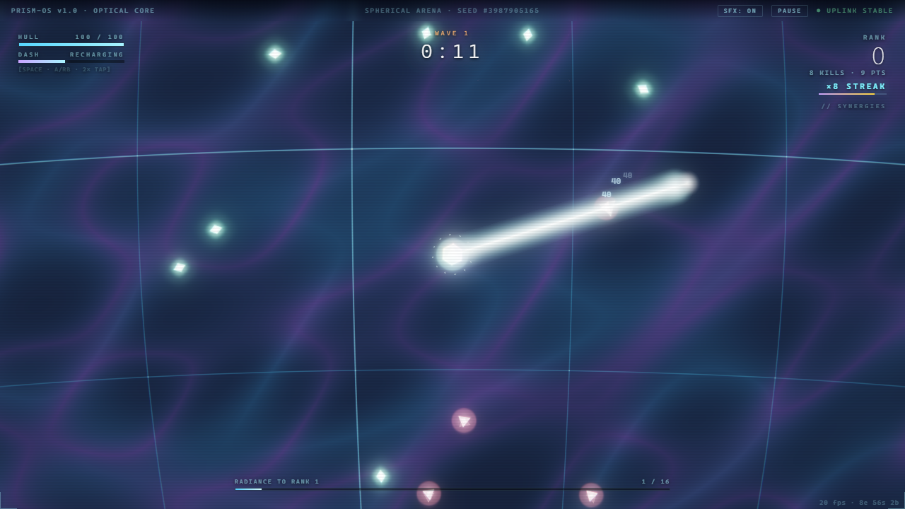

# Prism

[](https://prism.ericrolph.workers.dev/)
[](https://github.com/eric-rolph/prism-game)

Auto-firing light, refracted through shards you collect. A Vampire-Survivors-paced geometric roguelite on a 3D traversable crystal sphere — built in **Rust + WebAssembly + WebGL2 + procedural Web Audio DSP** and deployed to Cloudflare Workers (~94 kB gzip, zero external assets, strict `default-src 'none'` CSP).

**[▶ Play Live at prism.ericrolph.workers.dev](https://prism.ericrolph.workers.dev/)**

<p align="center">
  <a href="https://prism.ericrolph.workers.dev/">
    
  </a>
</p>

<p align="center">
  
</p>

**Controls:**
- **Keyboard:** `WASD` / Arrow keys to move · `Space` / `Shift` to Phase Dash · `1` / `2` / `3` to pick shards (`R` Reroll, `X` Skip) · `Esc` to Pause & inspect build
- **Gamepad:** Left stick / D-pad to move · `A` / `RB` / `RT` to Dash · `Start` to Pause · D-pad/`LB`/`RB` + `A`/`Y`/`B` in rank-up modal
- **Touch:** Drag anywhere for a virtual analog stick · Double-tap to Dash

## What it is

You glide across the surface of a luminous 3D sphere along exact great-circle geodesics. Light beams auto-fire toward nearby threats. Every rank-up offers three shard upgrades that compose multiplicatively (`Split`, `Refract`, `Mirror`, `Chromatic`, `Lens`, `Diffract`, `Echo`, `Halo`, `Cascade`, `Interference`, `Arc`, `Minefield`, `Lance`, and more). Stack shards to unlock **19 synergies** and **5 level-6 evolutions** as a trickle of thin cyan rays blossoms into hundreds of spectral beams, gravity wells, and crystalline constellations.

- **15-minute runs + Optional Endless Overdrive** after victory (or defeating the Void Prism)
- **Daily Seed Challenge** (deterministic UTC date seed shared worldwide) + `?seed=<n>` shareable URLs
- **23 shards · 19 synergies · 5 evolutions · 8 enemy archetypes · 3 multi-phase bosses**

## Visuals & Rendering Pipeline (WebGL2)

- **Sapphire Fresnel Crystal Globe & Deep-Space Starfield** — inverse-projected 3D sphere with anti-aliased `fwidth` meridian/parallel coordinates, glowing grid micro-beacons, dual-wave animated prismatic caustics, polar vortex rings, iridescent Fresnel limb corona, and multi-layer twinkling stars outside the horizon
- **GPU Faceted Geometric SDF Silhouettes** — instanced signed-distance shaders render distinct readable silhouettes per entity role: spinning prismatic hero crystal, rotating faceted diamond radiance gems, beveled crystal hexagons (obstacles, brutes, shields, mines), razor chevron swarm units, 8-point starburst elites/bosses, and **hollow optical wave rings** with subtle spectral RGB dispersion for interference pulses, dash blasts, barriers, and void shockwaves
- **Optical Plasma Beams** — SDF capsules with white-hot inner plasma core, travelling photon interference ripple, lateral spectral dispersion fringe, seamless edge-feathered halos, and emitter/impact tip flares
- **4-Level Dual Kawase HDR Bloom Pyramid + ACES Filmic Tonemap** — soft-knee luminance bright-pass → 4-octave downsample (`1/2 → 1/4 → 1/8 → 1/16`) → 8-tap tent additive upsample → Narkowicz ACES Filmic tone mapping, temporal persistence trails, build-scaled chromatic aberration, dynamic combat flashes, and low-HP heartbeat vignette
- **WebGL Context Loss & Restore Recovery** + selectable visual intensity (`HIGH` / `BALANCED` / `REDUCED`)
- **2D Floating Combat Overlay** — DPR-aware canvas rendering coalesced floating damage/crit/heal numbers, kill-streak & synergy/evolution milestone banners, and an off-screen directional boss chevron tracker

## Procedural Crystalline Audio Engine (Web Audio DSP)

Zero external audio files — 100% synthesized in real time:
- **Modal Glass-Bell Synthesis** using physical inharmonic bar partials (`1.0`, `2.756`, `5.404`) locked to a **D Lydian pentatonic lattice** so rapid gem pickup cascades climb melodically without dissonance
- **Stereo Ping-Pong Glass Cavern Delay** + master **`DynamicsCompressorNode`** + smooth **low-pass modal ducking** (`18.5 kHz ↔ 460 Hz`) when rank-up or pause overlays open
- **Adaptive Ambient & Combat Pulse Bed** that shifts harmonic density and rhythmic arpeggiation as build intensity and boss encounters escalate

## Simulation Architecture (Rust + WASM)

- **Zero-Copy WASM ↔ JS Linear Memory Bridge** — Rust packs flat `#[repr(C)]` buffers (`CircleInstance` 9 floats, `BeamInstance` 10 floats, `DamagePopup` 4 floats); TypeScript reads `Float32Array` views directly over `wasm.memory.buffer` with zero serialization
- **Zero-Allocation Flat Spatial Hash Grid (`src/spatial.rs`)** — O(N) tangent-plane spatial grid accelerates beam/area broadphase collision and deterministic enemy soft-separation so 1,000+ late-game swarms flow like liquid geometry instead of collapsing onto one pixel
- **Boss-Arena Crowd Relief** — major boss arrivals trigger a radial entrance shockwave and outer-crowd cull so boss engagements remain crisp, readable, and balanced within the 20–45 s TTK band
- **Combat Juice & Telemetry** — kill-streak combo tracker with decay bar, presentation-side hit-stop micro-slowmo on shield breaks & mega-kills, live DPS / Pause Build Inspector, local Top-5 leaderboard, and 1-click Copy Seed/Telemetry summary

## Stack

- **Rust** → `wasm-pack` + `wasm-opt` → WebAssembly (simulation, spatial grid, shard operators, geodesic globe math)
- **WebGL2** + **GLSL 300 ES** + **TypeScript** + **Vite** (renderer, 2D overlay, Web Audio DSP, HUD)
- **Cloudflare Workers** static assets via **Wrangler** with strict `Content-Security-Policy`
- **GitHub Actions** CI (`cargo test`) + live Workers deploy on push to `main`

## Prerequisites

- Rust stable (pinned in `rust-toolchain.toml`) with `wasm32-unknown-unknown` target
- [`wasm-pack`](https://rustwasm.github.io/wasm-pack/installer/)
- Node 22+

## Local development

```bash
# Run deterministic Rust simulation & spatial-grid tests
cargo test

# Rebuild the WASM module whenever anything under src/ changes
wasm-pack build --release --target web --out-dir web/wasm --out-name prism

# Start the Vite dev server
cd web
npm ci
npm run dev
```

Open http://localhost:5173.

## Layout

```
prism-game/
├── Cargo.toml                      Rust package manifest
├── rust-toolchain.toml             Pinned toolchain
├── src/
│   ├── lib.rs                      #[wasm_bindgen] surface + #[repr(C)] GPU/popup structs
│   ├── game.rs                     Simulation loop, globe geodesics, bosses, endless mode, draw packing
│   ├── spatial.rs                  Zero-allocation flat spatial hash grid for O(N) queries & separation
│   ├── shards.rs                   23 shard operators, 19 synergies, 5 evolutions, compose_salvo
│   ├── entities.rs                 Plain data structs
│   ├── math.rs                     Deterministic seeded xorshift RNG
│   └── game_tests.rs               Deterministic smoke, boss TTK, crowd relief & endless mode tests
├── web/
│   ├── index.html                  Strict-CSP self-contained shell, Title/Daily UI, HUD, Pause Inspector
│   ├── public/
│   │   ├── _headers                Strict Cloudflare security & CSP headers
│   │   └── favicon.svg             Geometric prism SVG favicon
│   └── src/
│       ├── main.ts                 Bootstrap, RAF loop, attract globe, HUD, Endless & Daily Seed
│       ├── renderer.ts             WebGL2 5-pass Dual Kawase HDR pipeline + context-loss recovery
│       ├── shaders.ts              GLSL 300 ES — faceted SDFs, beams, globe/starfield, Kawase, ACES
│       ├── overlay.ts              2D canvas floating damage numbers, banners & off-screen boss arrow
│       ├── audio.ts                Crystalline modal Web Audio DSP + stereo delay + adaptive pulse
│       └── input.ts                Keyboard, touch virtual stick & Gamepad API controller
├── wrangler.toml                   Cloudflare Workers config
└── .github/workflows/              ci.yml (cargo test) + deploy.yml (WASM + Vite + Workers)
```

## Shards

| Shard | Effect | Rarity |
|---|---|---|
| Split | Fan out more beams per volley | Common |
| Refract | Beams curve toward nearest enemy | Rare |
| Mirror | Fire in every direction | Common |
| Chromatic | Split into R/G/B sub-beams | Common |
| Lens | Thicker, heavier beams | Common |
| Diffract | Hits scatter into radial bursts | Rare |
| Echo | Second salvo after a short delay | Rare |
| Halo | Orbital beads strike on contact | Rare |
| Cascade | Kills fork into secondary beams | Legendary |
| Interference | Standing-wave pulses ripple outward | Legendary |
| Siphon | Beams heal you on every hit | Common |
| Frost | Beams slow enemies on hit | Common |
| Barrier | Energy shield absorbs + deals damage | Common |
| Thorns | Taking damage fires retaliatory beams | Rare |
| Magnet | Pull radiance gems from farther away | Common |
| Momentum | Move faster, shorten dash cooldown | Common |
| Armor | Reduce all incoming damage | Common |
| Luck | Rare/legendary shards appear more often | Rare |
| Prism Heart | +15 max HP per level | Common |
| Phase Step | Longer i-frames on dash | Rare |
| Arc | Chain lightning between nearby enemies | Rare |
| Minefield | Seed faceted charges that burst and pull | Legendary |
| Lance | Periodic heavy piercing rail shot | Rare |

## Evolutions (level two shards to 6)

| Evolution | Recipe | Effect |
|---|---|---|
| Afterimage Engine | Echo 6 + Momentum 6 | Dashing leaves firing echoes |
| Whiteout | Frost 6 + Diffract 6 | Frozen kills burst into freezing rays |
| Kaleidoscope | Split 6 + Mirror 6 | Every salvo fires a great-circle prismatic ring |
| Singularity | Magnet 6 + Interference 6 | Interference rings become gravity wells |
| Solar Crown | Halo 6 + Barrier 6 | Halo contacts recharge barrier; barrier hits flare orbitals |
